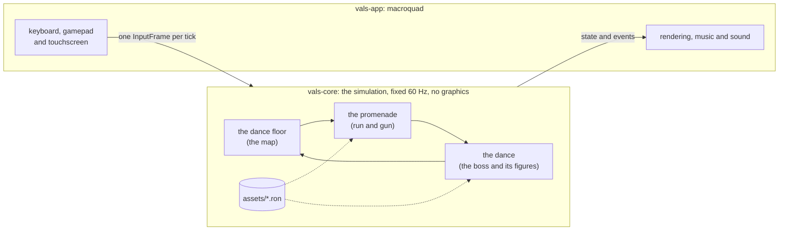

<div align="center">


# VALS

**A boss-rush danmaku with run-and-gun levels, written in Rust.**<br>
Five bosses that are five dances, and their bullets are the choreography.

[](https://diegocj30.github.io/vals/)

[](https://github.com/diegocj30/vals/actions/workflows/ci.yml)


[Español](README.md) · **English**


</div>

<table>
<tr>
<td width="50%" rowspan="2" align="center"><br><sub><b>Flamenco</b>: every bullet snaps aside on the accents of the twelve-beat compás</sub></td>
<td width="50%" align="center"><br><sub><b>Monsieur Loyal</b>, the Montmartre doorkeeper: the street stays locked until you beat him</sub></td>
</tr>
<tr>
<td align="center"><br><sub><b>The dance floor</b>: one monument per dance, between promenades</sub></td>
</tr>
</table>

The year is 1900, and tonight is the grand ball. At midnight the ballroom
comes alive: a music box, a bandoneon, a gramophone, a guitar and the chorus
girls on a poster run off, each with its music, to its own city.
**Scarlet**, the dancer with the red bow, sets off after them street by street
and challenges each one at its own dance.

Play it in the browser with keyboard, gamepad or touchscreen, nothing to
install; it also builds natively for desktop. In Spanish and English.

> The codebase (identifiers, comments, data files) is written in Spanish; the
> commands and names below are quoted exactly as they appear in it.

## Five dances, five bosses

Each boss has **an engine verb that belongs to it alone**, each phase is **a
real figure** of its dance, in the order it is learned, and the bullets land
**on the beat of its music**. A test stops any dance from using another
dance's verb.

<table>
<tr>
<td align="center" width="20%"></td>
<td align="center" width="20%"></td>
<td align="center" width="20%"></td>
<td align="center" width="20%"></td>
<td align="center" width="20%"></td>
</tr>
<tr>
<td align="center"><b>The Waltz</b><br><sub>Vienna · a music box</sub><br><br><code>Turn</code>: the aim rotates and a spiral comes out</td>
<td align="center"><b>The Tango</b><br><sub>Buenos Aires · a bandoneon</sub><br><br>negative <code>accel</code>: the bullet stops dead and comes back, like the corte</td>
<td align="center"><b>The Charleston</b><br><sub>Chicago · a gramophone</sub><br><br><code>spin</code>: the bullet curves, on the 3-3-2 clave</td>
<td align="center"><b>The Can-can</b><br><sub>Paris · the chorus girls</sub><br><br>short <code>ttl</code>: the kick fires and fades away</td>
<td align="center"><b>Flamenco</b><br><sub>Seville · a guitar</sub><br><br><code>quiebro</code>: the bullet snaps aside on the accents of the twelve-beat compás</td>
</tr>
</table>

<sub>Long-exposure photos of one figure from each dance, taken from the real simulation: every dot is a bullet, and the coloured line is the boss's path.</sub>

Seventeen figures in all, from the waltz's change step to the bulería's
remate. Flamenco is the `Final`-level dance: it opens once the other four are
won. **[The five dances, figure by figure →](docs/BAILES.en.md)**

<details>
<summary><b>The Waltz, third figure: the reverse turn, in motion</b></summary>
<br>
<p align="center"></p>
</details>

## Five promenades, five doorkeepers

Before each dance, its street: a run-and-gun level through the dance's city,
with enemies that move to its beat. Every promenade has **its flyer**, **a
fourth enemy** that breaks the rule, **a set piece halfway along** on moving
platforms and, at the end, **a doorkeeper** in an arena that stays locked until
you beat it.

<table>
<tr>
<td align="center" width="20%"></td>
<td align="center" width="20%"></td>
<td align="center" width="20%"></td>
<td align="center" width="20%"></td>
<td align="center" width="20%"></td>
</tr>
<tr>
<td align="center"><b>Vienna</b><br><sub>On the way to the ball</sub><br><br>the fiacre's boat<br>doorkeeper: <b>the conductor</b></td>
<td align="center"><b>The arrabal</b><br><sub>Along the Vuelta de Rocha</sub><br><br>the tram<br>doorkeeper: <b>the neighbourhood tough</b></td>
<td align="center"><b>Chicago</b><br><sub>High above the city</sub><br><br>the elevated train<br>doorkeeper: <b>the double bass player</b></td>
<td align="center"><b>Montmartre</b><br><sub>Uphill, all the way to the mill</sub><br><br>the Galette's sails<br>doorkeeper: <b>Monsieur Loyal</b></td>
<td align="center"><b>Triana</b><br><sub>Over the bridge of boats</sub><br><br>the boats on the Guadalquivir<br>doorkeeper: <b>the flamenco singer</b></td>
</tr>
</table>

Each promenade hides **dance tokens** (three per street and four in Triana,
sixteen in all), some along the way and some in hard-to-reach spots. They are
only yours once you reach the door, and **the dressmaker** trades them for
another shot type (fan, castanet, streamer) or a charm.

## Music from first editions

Every tune is **read bar by bar from old public-domain scores**, most of them
first editions, written down as note tables and synthesized at startup. There
is not a single audio file.

| Dance | Tune | Source |
|---|---|---|
| The Waltz | *The Blue Danube*, Strauss (1867) and *Over the Waves*, Rosas (1888) | First piano edition (Vienna, Spina, 1867); *Over the Waves* from an early Viennese edition |
| The Tango | *La Cumparsita*, Matos Rodríguez (1916) | A public transcription, checked against the score's incipit |
| The Charleston | *Maple Leaf Rag*, Joplin (1899) | First edition (Sedalia, John Stark & Son, 1899) |
| The Can-can | *Infernal Galop*, Offenbach (1858) | First edition of the vocal score (Paris, Heugel) |
| Flamenco | *Asturias (Leyenda)*, Albéniz (1892) | First edition (Madrid, Casa Dotesio, 1901) |

In the ballroom, between dances, a piece plays that **gets back one instrument
for every dance you win**.

## Game modes

- **The story.** A five-plate prologue, the dance floor with its five
  promenades and five dances, and an ending once you win them all. Every dance
  is graded from D to A+ (time, hits taken, parries and supers) on a card with
  its own seal.
- **All night long** (*Toda la noche*). The five dances back to back, on the
  same lives and against the clock. It opens once all five are won, and your
  best time goes into the dance card.
- **Practice.** Any figure you have already reached, on its own, from **the
  dance card**: it costs no lives, nothing is recorded and nothing is saved.
  It is also offered when you fall, to practise exactly the figure that beat
  you.
- **Simple.** For first-timers: half the bullets, one figure fewer per dance
  and grades up to B.

And everywhere: hearts on the HUD, figure changes you can see (swept bullets
burst), **parry** on pink bullets to fill the meter and a **super** that clears
the screen. The game rewards weaving into the bullets instead of running from
all of them.

## How it's built

| 0 images | 32,000 bullets at 144 fps | 4 KB per 30 s of play | 521 tests |
|:---:|:---:|:---:|:---:|
| Everything is drawn in code, and the music is synthesized at startup | Instanced rendering; with macroquad's primitives, 30 fps | A run is a seed plus the list of inputs | Including bots that play every promenade end to end |



- **Deterministic simulation in a pure crate.** `vals-core` is the whole game
  (bullets, bosses, player, promenades, map) and depends on neither macroquad
  nor any graphics library. It advances on a fixed 60 Hz step with its own
  random number generator, and `vals-app` only adds the window, rendering,
  input and audio on top, interpolating between ticks.
- **A golden replay guards the gameplay.** A versioned replay is played back on
  every push, comparing state fingerprints: if gameplay changes
  unintentionally, it fails. That is what makes it safe to optimize the hot
  loop.
- **A bot that really dodges, with no invulnerability.** It clones the world,
  tries every direction a few ticks ahead and keeps the one that doesn't get
  hit; it plays every figure of every dance and counts the hits. That measures
  whether a figure is fair, not just whether it works.
- **Tests that guard the design, not just the code.** One requires each dance
  to use its own verb and no one else's; another plants a motionless player
  at every point on the screen so that **no figure leaves a spot where you
  can stand still without dodging**; another checks that every flamenco
  curtain leaves its gap.
- **Bosses and levels are data.** Each boss is a RON file with a small pattern
  language (`Fire`, `Turn`, `Repeat`, `Parallel`, `MoveTo`...), and each
  promenade is another RON file with its ground, platforms and enemies. Native
  builds have **hot-reload**: save the file and the change is live without
  recompiling.
- **Everything is code.** Characters are animated skeletons with Bézier-curve
  limbs, bullets come from a shader with instanced rendering, and the scenery
  is procedural. The only art files are two OFL-licensed fonts.
- **Same code on native and web.** It compiles to `wasm32` without
  `wasm-bindgen`; gamepad support (gilrs on native, the Gamepad API on web) and
  saving (`localStorage`) are wired in through miniquad plugins a few lines
  long.
- **Measurements are written down.** [`docs/PERF.md`](docs/PERF.md) (in
  Spanish) is the performance log, with every optimization measured before and
  after, and the hitch hunt: a slow-frame logger that says what happened in
  each one (the ballroom music, once synthesized in a single frame of up to
  157 ms, now comes out in 2 ms slices per frame). CI runs `cargo fmt`,
  `clippy -D warnings`, the tests, the golden replay and the web build on
  every push.

## Controls

Keyboard, gamepad or touchscreen, and the on-screen hints follow whichever was
used last. Shoot, jump, dash, parry, super and focus **can be remapped** under
*Options > Controls*, separately for keyboard and gamepad.

<details>
<summary><b>Playing</b></summary>
<br>

| | Keyboard | Gamepad | Touchscreen |
|---|---|---|---|
| Move | Arrows / WASD | Stick or D-pad | Stick that appears under your left thumb |
| Shoot | `Z` | R1 / R2 (RB / RT) | Big button: stays on, tap again to stop |
| Jump (on promenades) | Up / `W` / `K` | Bottom face button (X on PlayStation, A on Xbox) | *Jump* button |
| Dash, with invulnerability | `X` | Square / X | *Dash* button |
| Parry | `C` | Circle / B | *Parry* button |
| Super | `Space` / `V` | Triangle / Y | *Super* button |
| Focus (slow; on promenades, plant and aim) | `Shift` | L1 / L2 (LB / LT) | *Focus* button |
| Pause | `Esc` / `P` | Options / Start | Top-right button |
| Retry the dance or promenade | `R` | Share / Back | From the pause menu |

</details>

<details>
<summary><b>Menus, map and modes</b></summary>
<br>

| | Keyboard | Gamepad |
|---|---|---|
| Confirm | `Z` / `Enter` / `Space` | Bottom face button |
| Back, and leave the dance floor or the shop | `Esc` / `Backspace` | Circle / B |
| Options (from the menu) | `Esc` / `P` | Options / Start |
| The dance card and practice (from the menu) | `L` | L1 / LB |
| Practise the figure you fell in (after falling) | `L` | L1 / LB |
| All night long (from the menu, with all five won) | `N` | R1 / RB |
| Replay the story (from the menu) | `X` | Square / X |
| Replay the ending (from the menu, once seen) | `V` | Triangle / Y |
| Replay a finished promenade (on the map) | `X` | Square / X |
| Turn off the ink wobble | `T` (also in options) | |
| Mute | `M` | |

On a touchscreen, tapping confirms in menus and the top-left button goes back;
in the options, the shop and the dance card you tap the row, the item or the
figure. On the dance floor the stick moves the dancer and a tap steps into the
dance.

While paused the dance stops completely (not a single tick advances, so
replays are unaffected), and you can resume, retry, go back to the dance floor
or open the options: language, difficulty, music and sound effects volume,
wobbly ink, screen shake, fullscreen (desktop only) and controls. Options are
saved along with progress.

</details>

## Building

You need stable Rust.

```bash
cargo run -p vals-app --release   # play natively
cargo test --workspace            # the tests, including the golden replay
cargo run --release -p vals-core --example esquivar   # the bot's hits, figure by figure
```

<details>
<summary><b>Web build, replays and measurements</b></summary>
<br>

Web build (Windows; on other systems it's the same two steps as the script):

```powershell
powershell -File scripts/build-web.ps1
python -m http.server 8080 --directory web
```

Replays, measurements and the dance images:

```bash
cargo run -p vals-core --example replay_tool -- verify assets/replays/golden.valsrpl
cargo run -p vals-app -- --replay replays/<file>.valsrpl   # F2 saves the current run
cargo run -p vals-core --example partituras   # regenerates docs/media/partituras
cargo bench -p vals-core --bench sim
cargo run -p vals-app --release -- --bench-scene 20000 --frames 400
cargo run -p vals-app --release -- --pruebas  # hitch logger and test shortcuts
```

| Crate | What it does |
|---|---|
| `crates/vals-core` | The simulation: deterministic, no graphics dependencies. |
| `crates/vals-app` | Window, rendering, input and audio with macroquad. |

</details>
