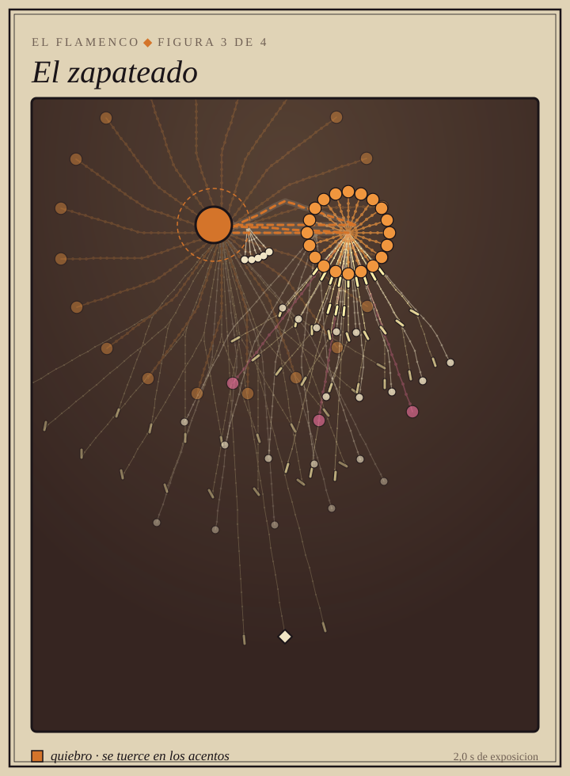
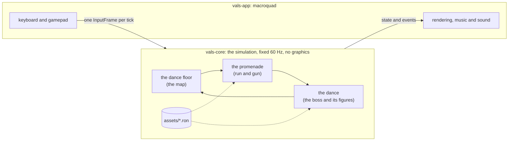

<div align="center">


# VALS

**A boss-rush danmaku with run-and-gun levels, written in Rust.**<br>
Every boss is a dance, and its bullets are the choreography.

[](https://diegocj30.github.io/vals/)

[](https://github.com/diegocj30/vals/actions/workflows/ci.yml)


[Español](README.md) · **English**


</div>

| The Waltz, third figure | The dance floor, the map between dances |
|:---:|:---:|
|  |  |

Keyboard, gamepad or touchscreen, nothing to install. It also builds natively for desktop.

> The codebase (identifiers, comments, data files) is written in Spanish; the
> commands and names below are quoted exactly as they appear in it.

## The story

> The year is 1900, and tonight is the grand ball. At midnight the ballroom
> comes alive: a music box, a bandoneon, a gramophone, a guitar and the chorus
> girls on a poster. They say no one there can dance their dance, and each takes
> its music away to its own city: **Vienna, Buenos Aires, Chicago, Paris and
> Seville**.
>
> The dancer with the scarlet bow sets off after them, street by street, and
> challenges each one at its own dance. Beat it, and it comes back to the
> ballroom.

It is told in a five-plate prologue that can be replayed from the menu with
`X` (Square). Win all five dances and the ending follows.

## Every boss is a dance

And not just in name: each one has **an engine verb that belongs to it alone**,
each phase is **a real figure** of that dance, and the bullets land **on the
beat of its music**. A test stops any dance from using another dance's verb.

<table>
<tr>
<td align="center" width="20%"></td>
<td align="center" width="20%"></td>
<td align="center" width="20%"></td>
<td align="center" width="20%"></td>
<td align="center" width="20%"></td>
</tr>
<tr>
<td align="center"><b>The Waltz</b><br><sub>Vienna · a music box</sub><br><br><code>Turn</code>: the aim rotates and a spiral comes out</td>
<td align="center"><b>The Tango</b><br><sub>Buenos Aires · a bandoneon</sub><br><br>negative <code>accel</code>: the bullet stops dead and comes back, like the corte</td>
<td align="center"><b>The Charleston</b><br><sub>Chicago · a gramophone</sub><br><br><code>spin</code>: the bullet curves, on the 3-3-2 clave</td>
<td align="center"><b>The Can-can</b><br><sub>Paris · the chorus girls</sub><br><br>short <code>ttl</code>: the kick fires and fades away</td>
<td align="center"><b>Flamenco</b><br><sub>Seville · a guitar</sub><br><br><code>quiebro</code>: the bullet snaps aside on the accents of the twelve-beat compás</td>
</tr>
</table>

<sub>Long-exposure photos of one figure from each dance, taken from the real simulation: every dot is a bullet, and the coloured line is the boss's path.</sub>

**[The five dances, figure by figure →](docs/BAILES.en.md)** The real step,
how the bullets draw it, and a photo of every figure.

## What's inside

- **Five bosses that are living objects**, each with its own figures
  (phases), its own music and its own bullet grammar: the waltz turns, the
  tango stops dead, the charleston curves.
- **Four promenades**, run-and-gun levels before each boss: Vienna, a
  Buenos Aires arrabal, the Chicago rooftops and the climb up Montmartre to the
  Moulin Rouge.
- **Tokens and the dressmaker**: each promenade hides dance tokens, some
  along the way and some in hard-to-reach spots, which the shop trades for
  another shot type (fan, castanet, streamer) or a charm.
- **A map** with one monument per dance that opens up as you progress, and
  music that gets an instrument back with every dance you win.
- **Grades and the dance card**: every dance you win is graded from D to A+
  (time, hits taken, parries and supers) on a card with its own seal, and the
  dance card keeps your best times, your attempts and which figure you get hit
  in most.
- **Parry and super**: parrying pink bullets fills the meter, and the super
  clears the screen. The game rewards weaving into the bullets instead of
  running from all of them.
- **A Belle Époque poster look** with film grain, and public-domain music
  (Strauss, Juventino Rosas, Matos Rodríguez, Joplin, Offenbach) transcribed
  into note tables.
- **In Spanish and English**, with remappable controls and a simple mode for
  first-timers.

## How it's built

| 0 images | 32,000 bullets at 144 fps | 4 KB per 30 s of play | 499 tests |
|:---:|:---:|:---:|:---:|
| Everything is drawn in code, and the music is synthesized at startup | Instanced rendering; with macroquad's primitives, 30 fps | A run is a seed plus the list of inputs | Including bots that play every promenade end to end |



- **Deterministic simulation in a pure crate.** `vals-core` is the whole game
  (bullets, bosses, player, promenades, map) and depends on neither macroquad
  nor any graphics library. It advances on a fixed 60 Hz step with its own
  random number generator, and `vals-app` only adds the window, rendering,
  input and audio on top, interpolating between ticks.
- **A golden replay guards the gameplay.** A versioned replay is played back on
  every push, comparing state fingerprints: if gameplay changes
  unintentionally, it fails. That is what makes it safe to optimize the hot
  loop.
- **Bosses and levels are data.** Each boss is a RON file with a small pattern
  language (`Fire`, `Turn`, `Repeat`, `Parallel`, `MoveTo`...), and each
  promenade is another RON file with its ground, platforms and enemies. Native
  builds have **hot-reload**: save the file and the change is live without
  recompiling.
- **Everything is code.** Characters are animated skeletons with Bézier-curve
  limbs, bullets come from a shader with instanced rendering, and the scenery
  is procedural. The only art files are two OFL-licensed fonts.
- **Tests that guard the design, not just the code.** One requires each dance
  to use its own engine verb and no one else's, and another plants a motionless
  player at every point on the screen so that no figure leaves a spot where
  you can stand still without dodging.
- **Same code on native and web.** It compiles to `wasm32` without
  `wasm-bindgen`; gamepad support (gilrs on native, the Gamepad API on web) and
  saving (`localStorage`) are wired in through miniquad plugins a few lines
  long.
- **Measurements are written down.** [`docs/PERF.md`](docs/PERF.md) (in
  Spanish) is the performance log, with every optimization measured before and
  after. CI runs `cargo fmt`, `clippy -D warnings`, the tests, the golden
  replay and the web build on every push.

## Controls

| | Keyboard | Gamepad | Touchscreen |
|---|---|---|---|
| Move | Arrows / WASD | Stick or D-pad | Stick that appears under your left thumb |
| Shoot | `Z` | R1 / R2 (RB / RT) | Big button: stays on, tap again to stop |
| Jump (on promenades) | Up / `W` / `K` | Bottom face button (X on PlayStation, A on Xbox) | *Jump* button |
| Dash, with invulnerability | `X` | Square / X | *Dash* button |
| Parry | `C` | Circle / B | *Parry* button |
| Super | `Space` / `V` | Triangle / Y | *Super* button |
| Focus (slow; on promenades, plant and aim) | `Shift` | L1 / L2 (LB / LT) | *Focus* button |
| Pause and, on the title screen, options | `Esc` / `P` | Options / Start | Top-right button |
| Retry the dance or promenade | `R` | Share / Back | From the pause menu |

<details>
<summary><b>Menus, map and options</b></summary>
<br>

| | Keyboard | Gamepad |
|---|---|---|
| Confirm in menus | `Z` / `Enter` / `Space` | Bottom face button |
| Back, and leave the dance floor or the shop | `Esc` / `Backspace` | Circle / B |
| Open the dance card (from the menu) | `L` | L1 / LB |
| Replay the story (from the menu) | `X` | Square / X |
| Replay the ending (from the menu, once seen) | `V` | Triangle / Y |
| Replay a finished promenade (on the map) | `X` | Square / X |
| Turn off the ink wobble | `T` (also in options) | |
| Mute | `M` | |

Shoot, jump, dash, parry, super and focus **can be remapped**, separately for
keyboard and gamepad, under *Options > Controls*: pick the action and press the
new key or button. If another action already had it, the two swap, so no
action is ever left unbound. On-screen hints show the keyboard, gamepad or
touchscreen buttons, whichever was used last.

On a touchscreen, tapping confirms in menus and the top-left button goes back;
in the options and the shop you tap the row or the item. On the title screen
you tap its hints (the dance card, the story), and on the dance floor the stick
moves the dancer and a tap steps into the dance.

While paused the dance stops completely (not a single tick advances, so
replays are unaffected), and you can resume, retry, go back to the dance floor
or open the options: language, difficulty (regular or simple: half the
bullets, one figure fewer and grades up to B), music and sound effects volume,
wobbly ink, screen shake, fullscreen (desktop only) and controls. Options are saved along
with progress.

</details>

## Building

Requires stable Rust.

```bash
cargo run -p vals-app --release   # play natively
cargo test                        # tests, including the golden replay
```

<details>
<summary><b>Web build, replays and benchmarks</b></summary>
<br>

Web build (Windows; on other systems it's the same two steps as the script):

```powershell
powershell -File scripts/build-web.ps1
python -m http.server 8080 --directory web
```

Replays, benchmarks and the dance images:

```bash
cargo run -p vals-core --example replay_tool -- verify assets/replays/golden.valsrpl
cargo run -p vals-app -- --replay replays/<file>.valsrpl   # F2 saves the current run
cargo run -p vals-core --example partituras   # regenerates docs/media/partituras
cargo bench -p vals-core --bench sim
cargo run -p vals-app --release -- --bench-scene 20000 --frames 400
```

| Crate | What it does |
|---|---|
| `crates/vals-core` | The simulation: deterministic, no graphics dependencies. |
| `crates/vals-app` | Window, rendering, input and audio with macroquad. |

</details>
