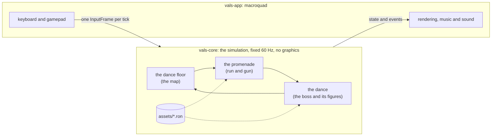

[Espanol](README.md) | **English**

# VALS

**A boss-rush danmaku with run-and-gun levels, written in Rust. Every boss is a
dance, and its bullets are the choreography.**

**[Play in the browser](https://diegocj30.github.io/vals/)** — keyboard or
gamepad, nothing to install.


| The Waltz, third figure | The dance floor, the map between dances |
|---|---|
|  |  |

> The codebase (identifiers, comments, data files) is written in Spanish; the
> commands and names below are quoted exactly as they appear in it.

## The story

In 1900, on the night of the grand ball, four things in the ballroom come
alive at midnight: a music box, a bandoneon, a gramophone and a line of chorus
girls. Each one steals the music of its dance and flees to its own city:
Vienna, Buenos Aires, Chicago and Paris. The dancer with the scarlet bow sets
off after them, street by street through the promenades, and to win each song
back she has to out-dance its thief. It is told in a five-plate prologue that can be replayed from the menu
with `X` (Square). Winning all four dances brings up the ending, with the
credits, which from then on can be replayed from the menu with `V` (Triangle).

## Every boss is a dance

And not just in name: each one has **an engine verb that belongs to it alone**,
each phase is **a real figure** of that dance, and the bullets land **on the
beat of its music**. A test stops any dance from using another dance's verb.

| Dance | Its verb | Its figures |
|---|---|---|
| **The Waltz** | `Turn`: the aim rotates and a spiral comes out | the change step, the natural turn, the reverse turn, the fleckerl |
| **The Tango** | negative `accel`: the bullet stops dead and comes back, like the corte | the walk, the ochos, the molinete |
| **The Charleston** | `spin`: the bullet curves, like a foot pivoting on its ball, on the 3-3-2 clave | the basic, bee's knees, switching sides |
| **The Can-can** | short `ttl`: the kick fires and fades away | the battement, the port d'armes, the cartwheel and the grand ecart |

| The ochos: the rings stop and fold back onto the figure 8 the boss traces | The basic: every kick is an arc |
|---|---|
|  |  |

**[The four dances, figure by figure](docs/BAILES.en.md)**: the real step, how
the bullets draw it, and its long-exposure photo.

## What's inside

- **Four bosses that are living objects**: The Waltz is a music box, The Tango
  a bandoneon, The Charleston a gramophone and The Can-can a line of chorus
  girls. Each has its own figures (phases), its own music and its own bullet
  grammar: the waltz turns, the tango stops dead, the charleston curves.
- **Four promenades**, side-scrolling run-and-gun levels before each boss:
  Vienna, a Buenos Aires arrabal, the Chicago rooftops and the climb up
  Montmartre to the Moulin Rouge.
- **Tokens and the dressmaker**: each promenade hides dance tokens, some along
  the way and some in hard-to-reach spots, which the map's shop trades for
  another shot type (fan, castanet, streamer) or a charm. A finished promenade
  can be replayed from the map with `X` (Square) to collect the missing ones.
- **A map** with one monument per dance that opens up as you progress, with
  progress saved between sessions.
- **Grades and the dance card**: every dance you win is graded Cuphead-style
  (time, hits taken, parries and supers, from D to A+) on a card with its own
  seal, and the dance card keeps the best time and best grade for every dance
  and promenade, the number of attempts, and which figure you fall on most.
- **Parry and super**: parrying pink bullets fills the meter, and the super
  clears the screen. The game rewards weaving into the bullets instead of
  running from all of them.
- **Two ways to move**: bosses are dodged **flying**, like a classic danmaku,
  and promenades are run **on foot**, with gravity and jumping.
- A **Belle Epoque poster** look with film grain, and public-domain music
  (Strauss, Juventino Rosas, Joplin, Offenbach) transcribed into note tables.

## Controls

| | Keyboard | Gamepad |
|---|---|---|
| Move | Arrows / WASD | Stick or D-pad |
| Shoot | `Z` | R1 / R2 (RB / RT) |
| Jump (on promenades) | Up / `W` / `K` | Bottom face button (X on PlayStation, A on Xbox) |
| Dash, with invulnerability | `X` | Square / X |
| Parry | `C` | Circle / B |
| Super | `Space` / `V` | Triangle / Y |
| Focus (slow; on promenades, plant and aim) | `Shift` | L1 / L2 (LB / LT) |
| Intermission (pause) and, on the title screen, options | `Esc` / `P` | Options / Start |
| Retry the dance or promenade, at any time | `R` | Share / Back |
| Confirm in menus | `Z` / `Enter` / `Space` | Bottom face button |
| Back in menus, and leave the dance floor or the shop | `Esc` / `Backspace` | Circle / B |
| Open the dance card (from the menu) | `L` | L1 / LB |
| Replay the story (from the menu) | `X` | Square / X |
| Replay the ending (from the menu, once all four dances are won) | `V` | Triangle / Y |
| Turn off the ink wobble | `T` (also in options) | |
| Mute | `M` | |

Shoot, jump, dash, parry, super and focus **can be remapped**, separately for
keyboard and gamepad, under *Options > Controls*: pick the action and press the
new key or button. If another action already had it, the two swap, so no
action is ever left unbound. Move, pause and retry are fixed. On-screen hints
always refer to the keyboard or the gamepad, whichever was used last.

During the intermission the dance stops completely (not a single tick
advances, so replays are unaffected), and you can resume, retry, go back to
the dance floor or open the options: language (Spanish or English), music and
sound effects volume, wobbly
ink, screen shake, fullscreen (desktop build only) and controls. Options are
saved along with progress.

## How it's built



- **Deterministic simulation in a pure crate.** `vals-core` is the whole game
  —bullets, bosses, player, promenades, map— and depends on neither macroquad
  nor any graphics library. It advances on a fixed 60 Hz step with its own
  random number generator, and `vals-app` only adds the window, rendering,
  input and audio on top, interpolating between ticks.
- **Replays and a golden regression test.** Because the simulation is
  deterministic, a run is just a seed plus the list of inputs: 30 seconds take
  4 KB. A versioned replay is played back on every push, comparing state
  fingerprints; if gameplay changes unintentionally, it fails. That is what
  makes it safe to optimize the hot loop.
- **Bosses and levels are data.** Each boss is a RON file with a small pattern
  language (`Fire`, `Turn`, `Repeat`, `Parallel`, `MoveTo`...), and each
  promenade is another RON file with its ground, platforms and enemies. Native
  builds have **hot-reload**: save the file and the change is live without
  recompiling.
- **Zero images.** Everything on screen is drawn in code: characters as
  animated skeletons with Bezier-curve limbs, bullets from a shader with
  instanced rendering (at 32,000 bullets, 144 fps versus 30 with macroquad's
  primitives) and procedural scenery. Music and sound effects are synthesized
  at startup. The only art files are two OFL-licensed fonts.
- **Same code on native and web.** It compiles to `wasm32` without
  `wasm-bindgen`; gamepad support (gilrs on native, the Gamepad API on web) and
  saving (`localStorage`) are wired in through miniquad plugins a few lines
  long.
- **420 tests**, including bots that play through every promenade end to end,
  tests that require each dance to use its own engine verb and no one else's,
  and one that plants a motionless player at every point on the screen so that
  no figure leaves a spot where you can stand still without dodging. CI runs
  `cargo fmt`, `clippy -D warnings`, the tests, the golden replay and the web
  build on every push.
- **Measurements are written down.** [`docs/PERF.md`](docs/PERF.md) (in
  Spanish) is the performance log, with every optimization measured before and
  after.

## Building

Requires stable Rust.

```bash
cargo run -p vals-app --release   # play natively
cargo test                        # tests, including the golden replay
```

Web build (Windows; on other systems it's the same two steps as the script):

```powershell
powershell -File scripts/build-web.ps1
python -m http.server 8080 --directory web
```

Replays, benchmarks and the dance images:

```bash
cargo run -p vals-core --example replay_tool -- verify assets/replays/golden.valsrpl
cargo run -p vals-app -- --replay replays/<file>.valsrpl   # F2 saves the current run
cargo run -p vals-core --example partituras   # regenerates docs/media/partituras
cargo bench -p vals-core --bench sim
cargo run -p vals-app --release -- --bench-scene 20000 --frames 400
```

| Crate | What it does |
|---|---|
| `crates/vals-core` | The simulation: deterministic, no graphics dependencies. |
| `crates/vals-app` | Window, rendering, input and audio with macroquad. |
