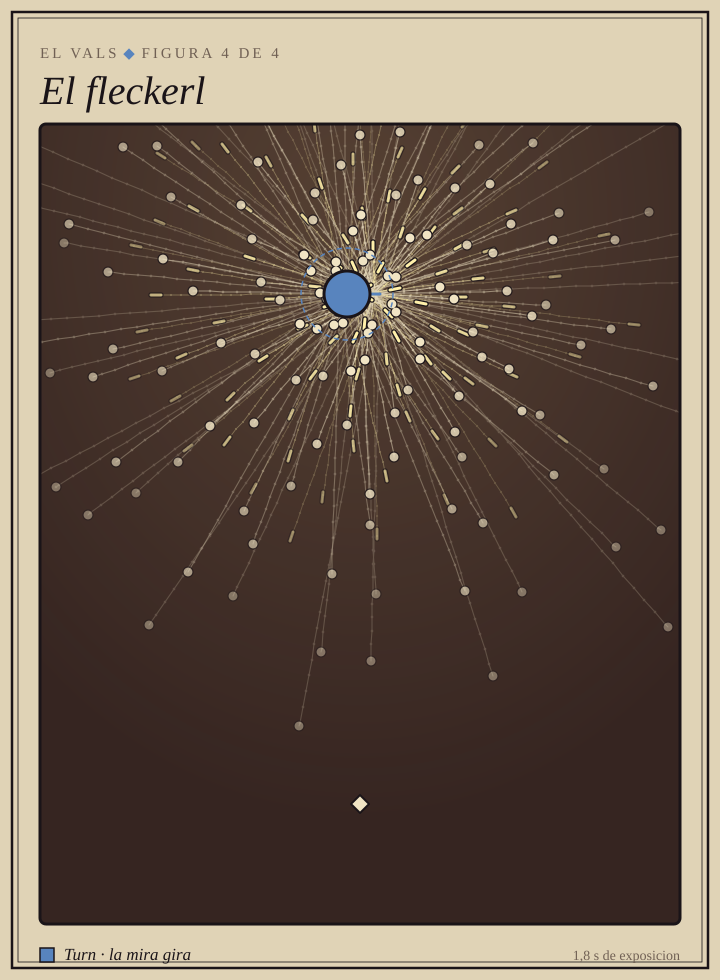
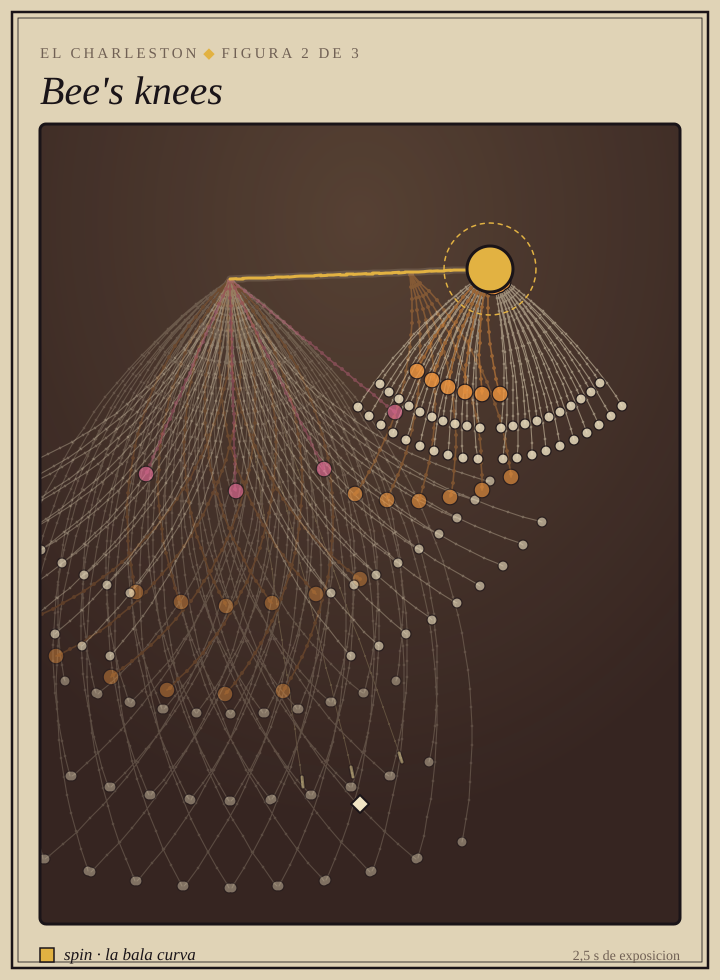
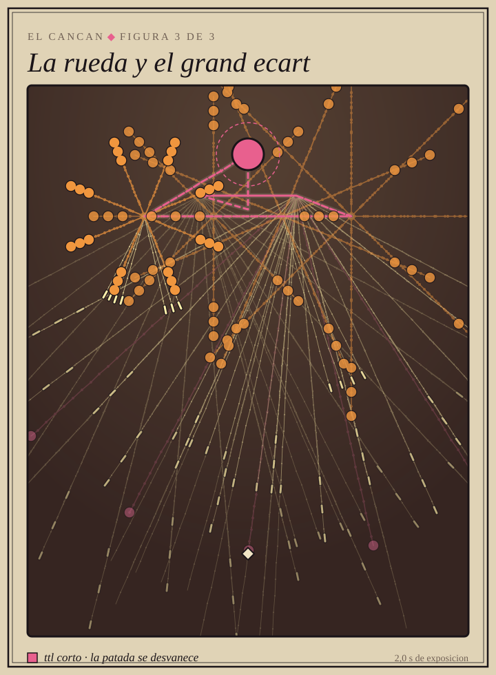
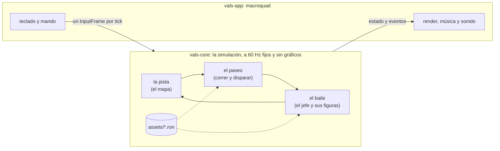

<div align="center">


# VALS

**Un boss-rush danmaku con niveles de correr y disparar, escrito en Rust.**<br>
Cada jefe es un baile, y sus balas son la coreografía.

[](https://diegocj30.github.io/vals/)

[](https://github.com/diegocj30/vals/actions/workflows/ci.yml)


**Español** · [English](README.en.md)


</div>

| El Vals, tercera figura | La pista, el mapa entre bailes |
|:---:|:---:|
|  |  |

Teclado, mando o pantalla táctil, sin instalar nada. También compila en nativo para escritorio.

## La historia

> Corre el año 1900 y esta noche hay gran baile. A medianoche el salón cobra
> vida: una caja de música, un bandoneón, un gramófono y las coristas
> pintadas en un cartel. Dicen que allí nadie sabe bailar lo suyo, y cada uno se lleva su
> música a su ciudad: **Viena, Buenos Aires, Chicago y París**.
>
> La bailarina del lazo escarlata sale tras ellos, calle a calle, y a cada uno
> lo reta en su propio baile. Si le gana, vuelve al salón.

Se cuenta en un prólogo de cinco láminas, que se vuelve a ver desde el menú con
`X` (cuadrado). Al ganar los cuatro bailes llega el final.

## Cada jefe es un baile

Y no solo de nombre: cada uno tiene **un verbo del motor que es solo suyo**,
cada fase es **una figura real** de ese baile y las balas caen **en el compás
de su música**. Un test impide que un baile use el verbo de otro.

<table>
<tr>
<td align="center" width="25%"></td>
<td align="center" width="25%"></td>
<td align="center" width="25%"></td>
<td align="center" width="25%"></td>
</tr>
<tr>
<td align="center"><b>El Vals</b><br><sub>Viena · una caja de música</sub><br><br><code>Turn</code>: la mira gira y sale la espiral</td>
<td align="center"><b>El Tango</b><br><sub>Buenos Aires · un bandoneón</sub><br><br><code>accel</code> negativa: la bala frena en seco y vuelve, como el corte</td>
<td align="center"><b>El Charleston</b><br><sub>Chicago · un gramófono</sub><br><br><code>spin</code>: la bala curva en la clave 3-3-2</td>
<td align="center"><b>El Cancán</b><br><sub>París · las coristas</sub><br><br><code>ttl</code> corto: la patada sale y se desvanece</td>
</tr>
</table>

<sub>Fotos de larga exposición de una figura de cada baile, sacadas de la simulación real: cada punto es una bala, y la línea de color, el camino del jefe.</sub>

**[Los cuatro bailes, figura a figura →](docs/BAILES.md)** El paso de verdad,
cómo lo dibujan las balas y la foto de cada figura.

## Qué hay dentro

- **Cuatro jefes que son objetos vivos**, con sus figuras (fases), su música
  y una gramática de balas propia: el vals gira, el tango frena en seco, el
  charleston curva.
- **Cuatro paseos** de correr y disparar antes de cada jefe: Viena, un
  arrabal de Buenos Aires, las azoteas de Chicago y la cuesta de Montmartre
  hasta el Moulin Rouge.
- **Fichas y la modista**: cada paseo esconde fichas de baile, unas en el
  camino y otras donde cuesta llegar, que en la tienda se cambian por otro
  tiro (abanico, castañuela, serpentina) o un amuleto.
- **Un mapa** con un monumento por baile, que se abre según avanzas, y una
  música que recupera un instrumento con cada baile ganado.
- **Nota y libro de baile**: cada baile ganado se puntúa de D a A+ (tiempo,
  golpes, parries y supers) en una tarjeta con su sello, y el libro guarda los
  mejores tiempos, los intentos y en qué figura te dan más golpes.
- **Parry y super**: parriar las balas rosas llena el medidor, y el super
  limpia la pantalla. El juego premia meterse entre las balas en vez de huir de
  todas.
- **Estética de cartel de la Belle Époque**, con grano de película, y música
  de dominio público (Strauss, Juventino Rosas, Matos Rodríguez, Joplin,
  Offenbach) transcrita a tablas de notas.
- **En español y en inglés**, con controles configurables y un modo sencillo
  para quien no ha jugado nunca.

## Cómo está hecho

| 0 imágenes | 32.000 balas a 144 fps | 4 KB por 30 s de partida | 440 tests |
|:---:|:---:|:---:|:---:|
| Todo se dibuja con código, y la música se sintetiza al arrancar | Render instanciado; con las primitivas de macroquad, 30 fps | Una partida es una semilla y la lista de inputs | Entre ellos, bots que recorren cada paseo de punta a punta |



- **Simulación determinista en un crate puro.** `vals-core` es todo el juego
  (balas, jefes, jugadora, paseos, mapa) y no depende de macroquad ni de
  ninguna librería gráfica. Avanza a paso fijo de 60 Hz con su propio generador
  aleatorio, y `vals-app` solo pone encima ventana, render, input y audio,
  interpolando entre ticks.
- **Un replay dorado vigila la jugabilidad.** Hay un replay versionado que se
  reproduce en cada push comparando huellas del estado: si la jugabilidad
  cambia sin querer, falla. Eso es lo que permite optimizar el bucle caliente
  sin miedo.
- **Jefes y niveles son datos.** Cada jefe es un fichero RON con un pequeño
  lenguaje de patrones (`Fire`, `Turn`, `Repeat`, `Parallel`, `MoveTo`...) y
  cada paseo, otro RON con su suelo, plataformas y enemigos. En nativo hay
  **hot-reload**: se guarda el fichero y el cambio entra sin recompilar.
- **Todo es código.** Los personajes son esqueletos animados con miembros en
  curva Bézier, las balas salen de un shader con render instanciado y los
  decorados son procedurales. Los únicos ficheros de arte son dos tipografías
  con licencia OFL.
- **Tests que vigilan el diseño, no solo el código.** Uno exige que cada baile
  use su verbo del motor y no el de otro, y otro planta a una jugadora quieta
  en cada punto de la pantalla para que ninguna figura deje un sitio donde
  quedarse sin esquivar.
- **El mismo código en nativo y en web.** Compila a `wasm32` sin
  `wasm-bindgen`; el mando (gilrs en nativo, Gamepad API en web) y el guardado
  (`localStorage`) se conectan con plugins de miniquad de unas pocas líneas.
- **Las mediciones están escritas.** [`docs/PERF.md`](docs/PERF.md) es el
  histórico de rendimiento, con cada optimización medida antes y después. El
  CI pasa `cargo fmt`, `clippy -D warnings`, los tests, el replay dorado y el
  build web en cada push.

## Controles

| | Teclado | Mando | Pantalla táctil |
|---|---|---|---|
| Mover | Flechas / WASD | Stick o cruceta | Stick que aparece bajo el pulgar izquierdo |
| Disparar | `Z` | R1 / R2 (RB / RT) | Botón grande: se queda puesto, otro toque lo quita |
| Saltar (en los paseos) | Arriba / `W` / `K` | Botón de abajo (X en PlayStation, A en Xbox) | Botón *Saltar* |
| Dash, con invulnerabilidad | `X` | Cuadrado / X | Botón *Dash* |
| Parry | `C` | Círculo / B | Botón *Parry* |
| Super | `Espacio` / `V` | Triángulo / Y | Botón *Super* |
| Focus (lento; en los paseos, plantarse y apuntar) | `Shift` | L1 / L2 (LB / LT) | Botón *Focus* |
| Pausa y, en el título, opciones | `Esc` / `P` | Options / Menu (Start) | Botón de arriba a la derecha |
| Reintentar el baile o el paseo | `R` | Share / View (Back) | Desde la pausa |

<details>
<summary><b>Menús, mapa y opciones</b></summary>
<br>

| | Teclado | Mando |
|---|---|---|
| Aceptar en los menús | `Z` / `Intro` / `Espacio` | Botón de abajo |
| Atrás, y salir de la pista o la tienda | `Esc` / `Borrar` | Círculo / B |
| Abrir el libro de baile (en el menú) | `L` | L1 / LB |
| Volver a ver la historia (en el menú) | `X` | Cuadrado / X |
| Volver a ver el final (en el menú, una vez visto) | `V` | Triángulo / Y |
| Repetir un paseo ya andado (en el mapa) | `X` | Cuadrado / X |
| Quitar el temblor de la tinta | `T` (también en opciones) | |
| Quitar el sonido | `M` | |

Disparar, saltar, dash, parry, super y focus **se pueden cambiar**, por
separado para el teclado y para el mando, en *Opciones > Controles*: se elige
la acción y se pulsa la tecla o el botón nuevo. Si ya lo tenía otra acción, se
intercambian, así que ninguna se queda sin nada. Las ayudas en pantalla
muestran los botones del teclado, del mando o de la pantalla según con cuál se
haya jugado lo último.

Con la pantalla táctil, en los menús tocar es aceptar y el botón de arriba a la
izquierda es atrás; en las opciones y en la tienda se toca la fila o la
prenda. En el título se tocan sus avisos (el libro, la historia), y en la pista
el stick mueve a la bailarina y un toque entra al baile.

En la pausa el baile se para del todo (no avanza ni un tick, así que los
replays no se enteran) y se puede seguir, reintentar, volver a la pista o ir a
las opciones: idioma, dificultad (normal o sencillo: la mitad de balas, una
figura menos y la nota hasta B), volumen de música y efectos, tinta temblorosa,
sacudida de pantalla, pantalla completa (solo en escritorio) y controles. Las opciones se
guardan con el progreso.

</details>

## Compilar

Hace falta Rust estable.

```bash
cargo run -p vals-app --release   # jugar en nativo
cargo test                        # tests, incluido el replay dorado
```

<details>
<summary><b>Build web, replays y mediciones</b></summary>
<br>

Build web (Windows; en otro sistema son los mismos dos pasos del script):

```powershell
powershell -File scripts/build-web.ps1
python -m http.server 8080 --directory web
```

Replays, mediciones y las imágenes de los bailes:

```bash
cargo run -p vals-core --example replay_tool -- verify assets/replays/golden.valsrpl
cargo run -p vals-app -- --replay replays/<fichero>.valsrpl   # F2 guarda la partida en curso
cargo run -p vals-core --example partituras   # regenera docs/media/partituras
cargo bench -p vals-core --bench sim
cargo run -p vals-app --release -- --bench-scene 20000 --frames 400
```

| Crate | Qué hace |
|---|---|
| `crates/vals-core` | La simulación: determinista, sin dependencias gráficas. |
| `crates/vals-app` | Ventana, render, input y audio con macroquad. |

</details>
