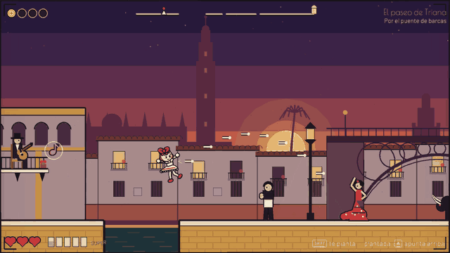
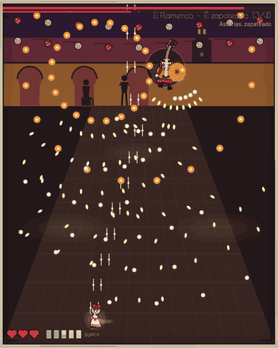
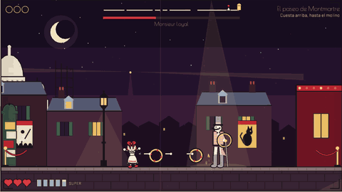
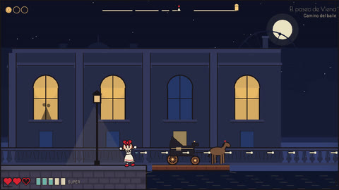
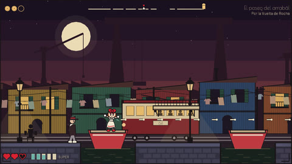
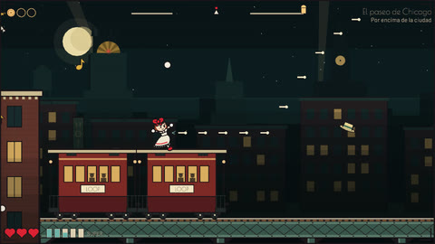
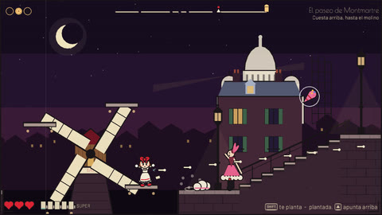
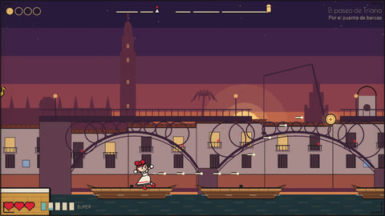
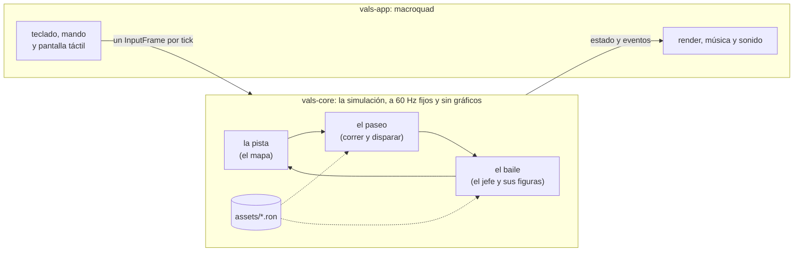

<div align="center">


# VALS

**Un boss-rush danmaku con niveles de correr y disparar, escrito en Rust.**<br>
Cinco jefes que son cinco bailes, y sus balas son la coreografía.

[](https://diegocj30.github.io/vals/)

[](https://github.com/diegocj30/vals/actions/workflows/ci.yml)


**Español** · [English](README.en.md)



</div>

<table>
<tr>
<td width="50%" rowspan="2" align="center"><br><sub><b>El Flamenco</b>: cada bala se quiebra en los acentos del compás de doce</sub></td>
<td width="50%" align="center"><br><sub><b>Monsieur Loyal</b>, portero de Montmartre: la calle se cierra hasta tumbarlo</sub></td>
</tr>
<tr>
<td align="center"><br><sub><b>La pista</b>: un monumento por baile, entre paseo y paseo</sub></td>
</tr>
</table>

Corre el año 1900 y esta noche hay gran baile. A medianoche el salón cobra
vida: una caja de música, un bandoneón, un gramófono, una guitarra y las
coristas de un cartel se escapan, cada uno con su música, a su ciudad.
**Escarlata**, la bailarina del lazo rojo, sale tras ellos calle a calle y los
reta, a cada uno, en su propio baile.

Se juega en el navegador con teclado, mando o pantalla táctil, sin instalar
nada, y compila en nativo para escritorio. En español y en inglés.

## Cinco bailes, cinco jefes

Cada jefe tiene **un verbo del motor que es solo suyo**, cada fase es **una
figura real** de su baile, en el orden en que se aprende, y las balas caen
**en el compás de su música**. Un test impide que un baile use el verbo de otro.

<table>
<tr>
<td align="center" width="20%"></td>
<td align="center" width="20%"></td>
<td align="center" width="20%"></td>
<td align="center" width="20%"></td>
<td align="center" width="20%"></td>
</tr>
<tr>
<td align="center"><b>El Vals</b><br><sub>Viena · una caja de música</sub><br><br><code>Turn</code>: la mira gira y sale la espiral</td>
<td align="center"><b>El Tango</b><br><sub>Buenos Aires · un bandoneón</sub><br><br><code>accel</code> negativa: la bala frena en seco y vuelve, como el corte</td>
<td align="center"><b>El Charleston</b><br><sub>Chicago · un gramófono</sub><br><br><code>spin</code>: la bala curva en la clave 3-3-2</td>
<td align="center"><b>El Cancán</b><br><sub>París · las coristas</sub><br><br><code>ttl</code> corto: la patada sale y se desvanece</td>
<td align="center"><b>El Flamenco</b><br><sub>Sevilla · una guitarra</sub><br><br><code>quiebro</code>: la bala se tuerce en los acentos del compás de doce</td>
</tr>
</table>

<sub>Fotos de larga exposición de una figura de cada baile, sacadas de la simulación real: cada punto es una bala, y la línea de color, el camino del jefe.</sub>

Diecisiete figuras en total, del paso de cambio del vals al remate de la
bulería. El Flamenco es el baile de nivel *Final*: se abre al ganar los otros
cuatro. **[Los cinco bailes, figura a figura →](docs/BAILES.md)**

<details>
<summary><b>El Vals, tercera figura: el giro inverso, en movimiento</b></summary>
<br>
<p align="center"></p>
</details>

## Cinco paseos, cinco porteros

Antes de cada baile, su calle: un nivel de correr y disparar por la ciudad del
baile, con enemigos que se mueven a su compás. Cada paseo tiene **su volador**,
**un cuarto enemigo** que rompe la regla, **un número a mitad de camino** sobre
plataformas que se mueven y, al final, **un portero** en una arena que se
cierra hasta tumbarlo.

<table>
<tr>
<td align="center" width="20%"></td>
<td align="center" width="20%"></td>
<td align="center" width="20%"></td>
<td align="center" width="20%"></td>
<td align="center" width="20%"></td>
</tr>
<tr>
<td align="center"><b>Viena</b><br><sub>Camino del baile</sub><br><br>la barca del fiacre<br>portero: <b>el director</b></td>
<td align="center"><b>El arrabal</b><br><sub>Por la Vuelta de Rocha</sub><br><br>el tranvía<br>portero: <b>el guapo del barrio</b></td>
<td align="center"><b>Chicago</b><br><sub>Por encima de la ciudad</sub><br><br>el tren elevado<br>portero: <b>el contrabajista</b></td>
<td align="center"><b>Montmartre</b><br><sub>Cuesta arriba, hasta el molino</sub><br><br>las aspas de la Galette<br>portero: <b>Monsieur Loyal</b></td>
<td align="center"><b>Triana</b><br><sub>Por el puente de barcas</sub><br><br>las barcas del Guadalquivir<br>portero: <b>la cantaora</b></td>
</tr>
</table>

Cada paseo esconde **fichas de baile** (tres por calle y cuatro en Triana,
dieciséis en total), unas de camino y otras donde cuesta llegar. Solo son
tuyas al llegar a la puerta, y **la modista** las cambia por otro tiro
(abanico, castañuela, serpentina) o un amuleto.

## Música de primeras ediciones

Cada tema está **leído compás a compás de partituras antiguas de dominio
público**, casi todas primeras ediciones, escrito como tablas de notas y
sintetizado al arrancar. No hay ni un fichero de audio.

| Baile | Tema | De dónde sale |
|---|---|---|
| El Vals | *El Danubio azul*, Strauss (1867) y *Sobre las olas*, Rosas (1888) | Primera edición para piano (Viena, Spina, 1867); *Sobre las olas*, de una edición vienesa antigua |
| El Tango | *La Cumparsita*, Matos Rodríguez (1916) | Una transcripción pública, cotejada con el íncipit de la partitura |
| El Charleston | *Maple Leaf Rag*, Joplin (1899) | Primera edición (Sedalia, John Stark & Son, 1899) |
| El Cancán | *Galop infernal*, Offenbach (1858) | Primera edición de la reducción para canto y piano (París, Heugel) |
| El Flamenco | *Asturias (Leyenda)*, Albéniz (1892) | Primera edición (Madrid, Casa Dotesio, 1901) |

En el salón, entre baile y baile, suena una pieza que **recupera un
instrumento por cada baile ganado**.

## Modos de juego

- **La historia.** Un prólogo de cinco láminas, la pista con sus cinco paseos
  y sus cinco bailes, y un final al ganarlos todos. Cada baile se puntúa de
  D a A+ (tiempo, golpes, parries y supers) en una tarjeta con su sello.
- **Toda la noche.** Los cinco bailes seguidos, con las mismas vidas y un
  reloj en marcha. Se abre al ganarlos todos, y el mejor tiempo queda en el
  libro.
- **Práctica.** Cualquier figura a la que ya se haya llegado, sola, desde
  **el libro de baile**:
  no quita vidas, no se graba y no apunta nada en el guardado. También se
  ofrece al caer, para practicar justo la figura que te ha tumbado.
- **Sencillo.** Para quien no ha jugado nunca a esto: la mitad de balas, una
  figura menos por baile y la nota hasta B.

Y por todas partes: corazones en el HUD, cambios de figura que se ven (las
balas barridas estallan), **parry** de las balas rosas para llenar el medidor y
**super** para limpiar la pantalla. El juego premia meterse entre las balas en
vez de huir de todas.

## Cómo está hecho

| 0 imágenes | 32.000 balas a 144 fps | 4 KB por 30 s de partida | 523 tests |
|:---:|:---:|:---:|:---:|
| Todo se dibuja con código, y la música se sintetiza al arrancar | Render instanciado; con las primitivas de macroquad, 30 fps | Una partida es una semilla y la lista de inputs | Entre ellos, bots que recorren cada paseo de punta a punta |



- **Simulación determinista en un crate puro.** `vals-core` es todo el juego
  (balas, jefes, jugadora, paseos, mapa) y no depende de macroquad ni de
  ninguna librería gráfica. Avanza a paso fijo de 60 Hz con su propio generador
  aleatorio, y `vals-app` solo pone encima ventana, render, input y audio,
  interpolando entre ticks.
- **Un replay dorado vigila la jugabilidad.** Un replay versionado se
  reproduce en cada push comparando huellas del estado: si la jugabilidad
  cambia sin querer, falla. Es lo que permite optimizar el bucle caliente sin
  miedo.
- **Un bot que esquiva de verdad, sin invulnerabilidad.** Clona el mundo,
  prueba cada dirección unos ticks hacia delante y se queda con la que no le
  da; juega cada figura de cada baile y cuenta los golpes. Así se mide si una
  figura es justa, no solo si funciona.
- **Tests que vigilan el diseño, no solo el código.** Uno exige que cada baile
  use su verbo y no el de otro; otro planta a una jugadora quieta en cada
  punto de la pantalla para que **ninguna figura deje un sitio donde quedarse
  sin esquivar**; otro comprueba que cada cortina del flamenco deja su hueco.
- **Jefes y niveles son datos.** Cada jefe es un fichero RON con un pequeño
  lenguaje de patrones (`Fire`, `Turn`, `Repeat`, `Parallel`, `MoveTo`...) y
  cada paseo, otro RON con su suelo, plataformas y enemigos. En nativo hay
  **hot-reload**: se guarda el fichero y el cambio entra sin recompilar.
- **Todo es código.** Los personajes son esqueletos animados con miembros en
  curva Bézier, las balas salen de un shader con render instanciado y los
  decorados son procedurales. Los únicos ficheros de arte son dos tipografías
  con licencia OFL.
- **El mismo código en nativo y en web.** Compila a `wasm32` sin
  `wasm-bindgen`; el mando (gilrs en nativo, Gamepad API en web) y el guardado
  (`localStorage`) se conectan con plugins de miniquad de unas pocas líneas.
- **Las mediciones están escritas.** [`docs/PERF.md`](docs/PERF.md) es el
  histórico de rendimiento, con cada optimización medida antes y después, y
  la caza de tirones: un registro de frames lentos que dice qué pasó en cada
  uno (la música del salón, que se sintetizaba de golpe en un frame de hasta
  157 ms, ahora sale a trozos de 2 ms por frame). El CI pasa `cargo fmt`, `clippy -D warnings`, los tests, el replay
  dorado y el build web en cada push.

## Controles

Teclado, mando o pantalla táctil, y las ayudas en pantalla hablan del que se
haya tocado lo último. Disparar, saltar, dash, parry, super y focus **se pueden
cambiar** en *Opciones > Controles*, por separado para teclado y mando.

<details>
<summary><b>Jugando</b></summary>
<br>

| | Teclado | Mando | Pantalla táctil |
|---|---|---|---|
| Mover | Flechas / WASD | Stick o cruceta | Stick que aparece bajo el pulgar izquierdo |
| Disparar | `Z` | R1 / R2 (RB / RT) | Botón grande: se queda puesto, otro toque lo quita |
| Saltar (en los paseos) | Arriba / `W` / `K` | Botón de abajo (X en PlayStation, A en Xbox) | Botón *Saltar* |
| Dash, con invulnerabilidad | `X` | Cuadrado / X | Botón *Dash* |
| Parry | `C` | Círculo / B | Botón *Parry* |
| Super | `Espacio` / `V` | Triángulo / Y | Botón *Super* |
| Focus (lento; en los paseos, plantarse y apuntar) | `Shift` | L1 / L2 (LB / LT) | Botón *Focus* |
| Pausa | `Esc` / `P` | Options / Menu (Start) | Botón de arriba a la derecha |
| Reintentar el baile o el paseo | `R` | Share / View (Back) | Desde la pausa |

</details>

<details>
<summary><b>Menús, mapa y modos</b></summary>
<br>

| | Teclado | Mando |
|---|---|---|
| Aceptar | `Z` / `Intro` / `Espacio` | Botón de abajo |
| Atrás, y salir de la pista o la tienda | `Esc` / `Borrar` | Círculo / B |
| Opciones (en el menú) | `Esc` / `P` | Options / Menu (Start) |
| El libro de baile y la práctica (en el menú) | `L` | L1 / LB |
| Practicar la figura en que se ha caído (al caer) | `L` | L1 / LB |
| Toda la noche (en el menú, con los cinco ganados) | `N` | R1 / RB |
| Volver a ver la historia (en el menú) | `X` | Cuadrado / X |
| Volver a ver el final (en el menú, una vez visto) | `V` | Triángulo / Y |
| Repetir un paseo ya andado (en el mapa) | `X` | Cuadrado / X |
| Quitar el temblor de la tinta | `T` (también en opciones) | |
| Quitar el sonido | `M` | |

Con la pantalla táctil, en los menús tocar es aceptar y el botón de arriba a la
izquierda es atrás; en las opciones, la tienda y el libro se toca la fila, la
prenda o la figura. En la pista el stick mueve a la bailarina y un toque entra
al baile.

En la pausa el baile se para del todo (no avanza ni un tick, así que los
replays no se enteran) y se puede seguir, reintentar, volver a la pista o ir a
las opciones: idioma, dificultad, volumen de música y efectos, tinta
temblorosa, sacudida de pantalla, pantalla completa (solo en escritorio) y
controles. Las opciones se guardan con el progreso.

</details>

## Compilar

Hace falta Rust estable.

```bash
cargo run -p vals-app --release   # jugar en nativo
cargo test --workspace            # los tests, incluido el replay dorado
cargo run --release -p vals-core --example esquivar   # golpes del bot, figura a figura
```

<details>
<summary><b>Build web, replays y mediciones</b></summary>
<br>

Build web (Windows; en otro sistema son los mismos dos pasos del script):

```powershell
powershell -File scripts/build-web.ps1
python -m http.server 8080 --directory web
```

Replays, mediciones y las imágenes de los bailes:

```bash
cargo run -p vals-core --example replay_tool -- verify assets/replays/golden.valsrpl
cargo run -p vals-app -- --replay replays/<fichero>.valsrpl   # F2 guarda la partida en curso
cargo run -p vals-core --example partituras   # regenera docs/media/partituras
cargo bench -p vals-core --bench sim
cargo run -p vals-app --release -- --bench-scene 20000 --frames 400
```

| Crate | Qué hace |
|---|---|
| `crates/vals-core` | La simulación: determinista, sin dependencias gráficas. |
| `crates/vals-app` | Ventana, render, input y audio con macroquad. |

</details>
