[Espanol](BAILES.md) | **English**

# The five dances

In VALS every boss is a real dance, and its bullets follow that dance's rules.
It isn't decoration: each one has **an engine verb that belongs to it alone**,
each phase is **a real figure** of that dance, in the order it is learned, and
the pattern's waits land **on the beat of its music**.

| Dance | Its verb | What the bullets do | Time signature |
|---|---|---|---|
| **The Waltz** | `Turn` | the aim rotates, and bullets come out in a spiral | 3/4 |
| **The Tango** | negative `accel` | they fly out, stop dead and come back the way they came | accented 4/4 |
| **The Charleston** | `spin` | they fly in arcs | 3-3-2 clave |
| **The Can-can** | short `ttl` | they cut across a slice of the floor and fade away | 2/4, the galop |
| **Flamenco** | `quiebro` | they fly straight and zigzag on every accent | twelve beats |

No dance borrowing its neighbor's verb isn't just an intention: a test enforces
it, `cada_baile_tiene_su_verbo_y_no_el_del_vecino` ("each dance has its own
verb and not its neighbor's") in
[`crates/vals-core/src/boss.rs`](../crates/vals-core/src/boss.rs). If the tango
starts turning or the waltz starts curving, CI fails.

## How to read the scores

Each image is a **long-exposure photo** of a figure, taken from the real
simulation: a motionless, invulnerable player at the bottom center (the white
diamond), not shooting, and the shutter left open for a couple of seconds.

- Every bullet fired during that time leaves its **trajectory**, with a dot
  every 4 ticks. Where the dots bunch up, the bullet was moving slowly.
- The brightest traces belong to the newest bullets.
- The colored dashed line is the **boss's path**: the pattern it draws on the
  floor.
- On top, a still frame of the last instant. The colors are the game's: bone
  for small bullets, yellow for needles, orange for medium ones, verdigris for
  large ones and **pink for parryable ones**.

They are generated by `cargo run -p vals-core --example partituras`
([`examples/partituras.rs`](../crates/vals-core/examples/partituras.rs)) from
the same RON files the game plays, so they can't lie: if a dance gets retuned,
rerun it and the images change with it.

---

## The Waltz

**Vienna, 19th century.** The Viennese waltz is the fast waltz of the Strauss
family, and it is almost all turning: clockwise (the **natural** turn) or
counterclockwise (the **reverse** turn), with change steps, which don't turn,
to switch from one direction to the other.

**The verb: `Turn`.** Each `Turn` twists the aim of the thread that is firing,
and volley after volley with a twisted aim makes a spiral. It is the only dance
that turns this way, and the sign is the direction of the dance: positive is
clockwise, negative counterclockwise.

```ron
Turn(0.31),   // the natural turn: clockwise, volley after volley
```

**The object: a music box**, lid open, with its ballerina spinning on top. It
turns because someone wound it up, and it dances in three-four time because
that is all it knows how to play. In the fleckerl it breaks: cracks and springs
flying.

**The music:** *The Blue Danube* (Johann Strauss II, 1866), the same Danube
mirrored into a minor key, *Over the Waves* (Juventino Rosas, 1888) and the
Danube's coda, a tone higher and at full speed.

| | |
|---|---|
| 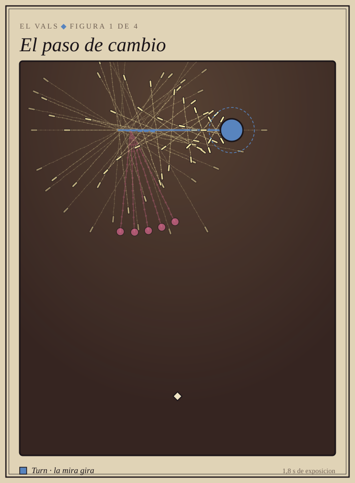 | **1. The change step.** On the floor: three steps without turning that switch the direction of the turn. It is the first thing taught.<br><br>In the game: three `Turn(0.2)` and three `Turn(-0.2)`. The spiral advances one bar to one side, comes back, and never completes a full turn: the gaps stay almost still. |
| 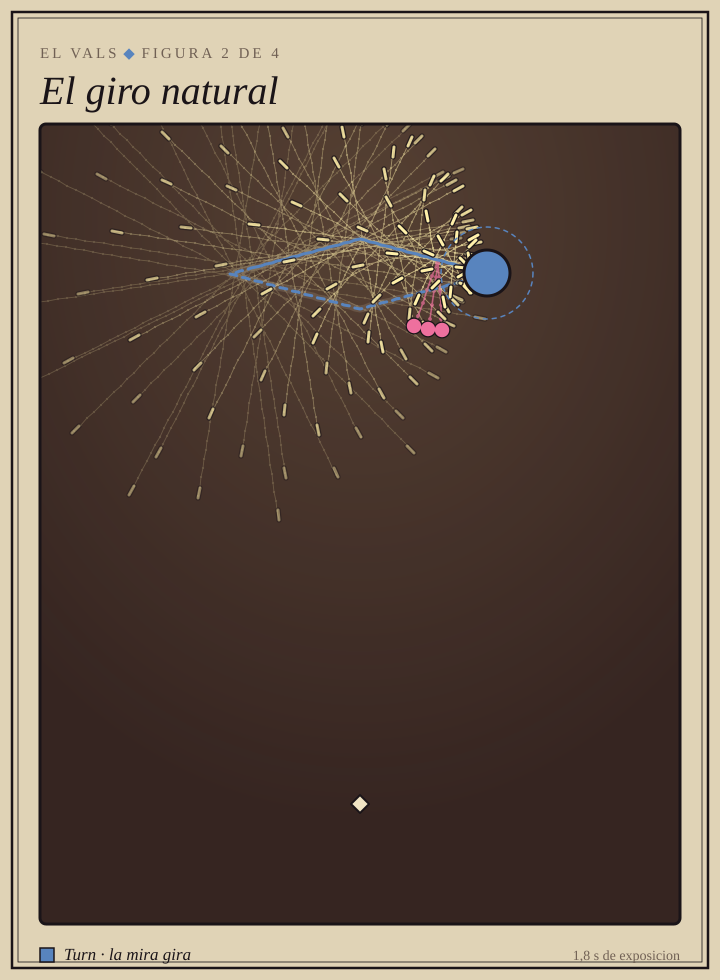 | **2. The natural turn.** On the floor: the clockwise turn.<br><br>In the game: two arms with positive `Turn`, clockwise, and the boss tracing its diamond clockwise too. |
| 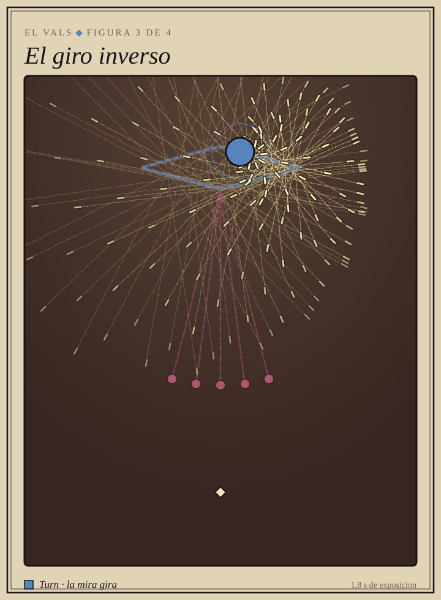 | **3. The reverse turn.** On the floor: the counterclockwise turn, the one that rotates the most.<br><br>In the game: the natural turn in a mirror. Negative `Turn`, the diamond traced backwards, and a little faster and denser, because it is learned later. |
|  | **4. The fleckerl.** On the floor: spinning very fast **on the spot**, in the center of the room, first reverse and then natural, with a *contra check* in between. The showpiece figure.<br><br>In the game: the boss plants itself in the center and both arms spin together counterclockwise and then clockwise. Right as the spin stops and reverses, the check: a fat pink ring and a burst aimed at you. |

> A spiral coils so tightly that in a still image it looks like an explosion:
> the turning shows in motion. It's the third-figure gif in the
> [README](../README.en.md).

---

## The Tango

**The Rio de la Plata, around 1880**, in the arrabales (outskirts) of Buenos
Aires and Montevideo. Early 20th-century manuals already speak of dancing *con
corte*: the corte is the dead stop, the brake in the middle of a step.

**The verb: negative `accel`.** The bullet flies out, runs out of speed and
comes back the way it came, right to the point where it was born. It is the
corte turned into a bullet. And **there isn't a single `Turn`** in the whole
file: the tango moves in straight lines and changes abruptly. Even the molinete
rotates in fixed-angle jumps.

```ron
accel: -190.0,   // the ochos: fly out, stop dead and come back
```

**The object: a bandoneon** with arms and a face. Its dance is the bellows: it
opens and closes in one go, overshoots a hair and locks in place until the next
beat. Bellows that breathed smoothly would be a waltz. It starts out as a
gallant, rose between its teeth, and in the molinete its bellows tear.

**The music:** *La Cumparsita* (Matos Rodriguez, 1916): first part, second
part and back to the first, at full tilt. At 120 quarter notes per minute a
beat is 30 ticks, and every wait in the pattern is a multiple of 30: **the
bullets land with the music**.

| | |
|---|---|
| 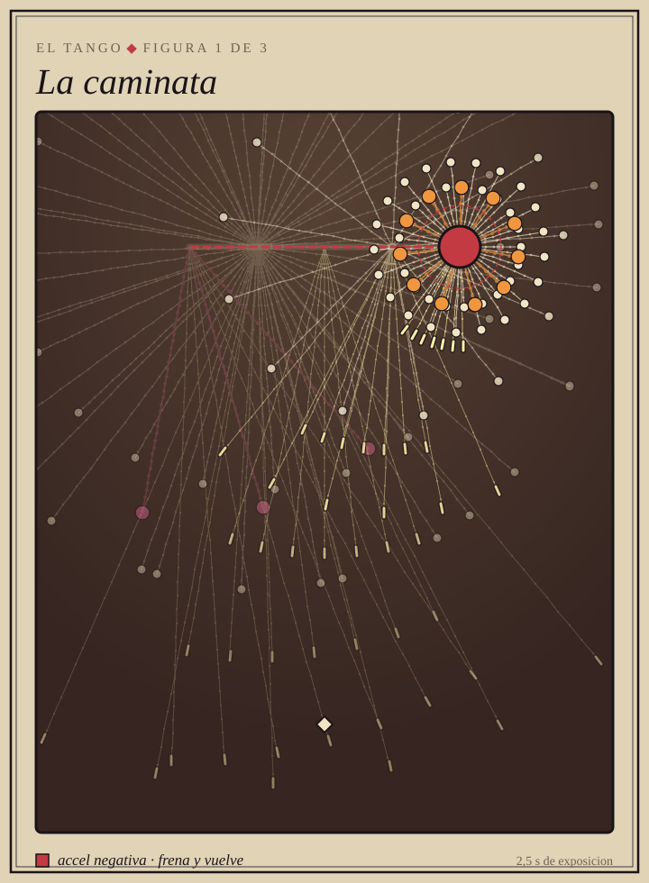 | **1. The walk.** On the floor: the tango step, straight, accented and with a pause.<br><br>In the game: the boss walks for one bar and holds still for the next. As it stops it releases a ring that brakes gently and comes back, a small-scale stop to learn it. While it walks, a straight shot at you on every beat: the volleys line up staggered along its path, like footprints. |
|  | **2. The ochos.** On the floor: she crosses in front, pivots and crosses to the other side, and her feet draw an 8 on the floor.<br><br>In the game: the boss draws the 8 in straight lines, and at each pivot it releases a ring of large bullets that brake and return to their spot: the rings close one after another **onto the drawing**. The fans alternate from side to side, like the hips. |
| 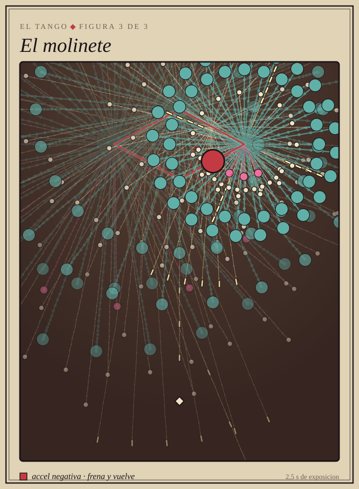 | **3. The molinete.** On the floor: she circles the man in four steps, forward, side, back, side, and he acts as the axis.<br><br>In the game: the boss traces a diamond, one step every two beats. At each corner, a two-layer stop and the windmill's sails, a cross of needles that each corner twists by an eighth of a turn. The windmill turns, but in jolts. |

---

## The Charleston

**Charleston, South Carolina**, where it takes its name, and **Broadway,
1923**, where James P. Johnson's song in *Runnin' Wild* made it famous. It is
the step of the Twenties: the feet pivot on the ball, toes swinging out and in,
and the free foot kicks.

**The verb: `spin`.** The bullets fly curved. The foot's pivot is neither a
line nor a stop: it is an arc. Each kick flies out to one side and downward,
and the curve brings it back toward the other. And everything falls on **the
3-3-2 clave**: the bar is split into three, three and two eighth notes, and the
kicks land on those three hits.

```ron
spin: 0.5,   // the kick flies out and the curve brings it back
```

**The object: a gramophone** from the Twenties come to life: the record spins
on top, the flower horn is the mouth that sings on every beat, and the
cabinet's little legs do the step. Flapper headband and white gloves.

**The music:** *Maple Leaf Rag* (Scott Joplin, 1899), with swung eighth notes:
the second eighth of each beat lands late, and that is where the needles go.

| | |
|---|---|
|  | **1. The basic.** On the floor: the 1923 step, pivoting on the ball of the foot and kicking forward and back.<br><br>In the game: one kick on every hit of the clave, a fan that flies out to one side and sweeps toward the other. Two layers per kick, one faster than the other, and the corridor between them is where you cross. |
|  | **2. Bee's knees.** On the floor: hands on the knees; the knees come together, the hands switch to the opposite knee and, as they open, the knees seem to have passed through each other.<br><br>In the game: one fan per knee. Open, ( ), and the gap in the middle is the safe spot. Together, the arcs cross in an X at the player's height. The hands are the medium bullets, the white gloves. |
| 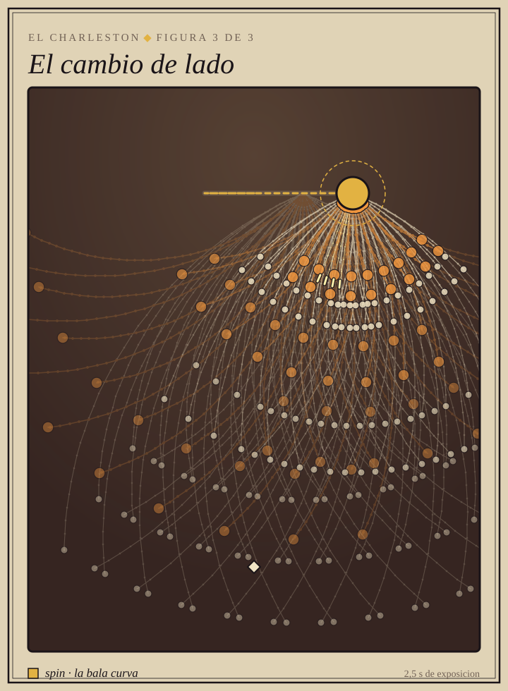 | **3. Switching sides.** On the floor: the end of the phrase, hopping across to the other side.<br><br>In the game: one bar dances in place and the next crosses the stage in four hops, releasing each volley where it lands. Three families that never sound at once: the kicks on the clave, the half turn on the swung eighth and the needles on the beat the clave skips. |

---

## The Can-can

**Paris, the popular dance halls of the 1830s.** It grew out of the last
figure of the quadrille, became the scandal of the music halls and the poster
of the Moulin Rouge. Its figures have names, and several come from military
drill.

**The verb: short `ttl`.** All of its bullets live two seconds or less, pink
ones included. Each kick is a fan that flies out, cuts across a slice of the
floor and fades: the screen clears itself within a bar, and what you have to
read is not the wall on top of you but where the next kick will land.

```ron
ttl: 1.8,   // the kick lasts as long as the kick
```

**The object: a line of chorus girls** holding hands. It is the only boss that
is still people, because a line of legs rising in unison is exactly what it
fires: its fans come out in a row. Flirtatious in the first figure, unhinged in
the last.

**The music:** Offenbach's *Infernal Galop* (1858), what everyone calls "the
can-can". It is the only dance in two-four time: 24 ticks per beat, and every
wait is a multiple of 12.

| | |
|---|---|
| 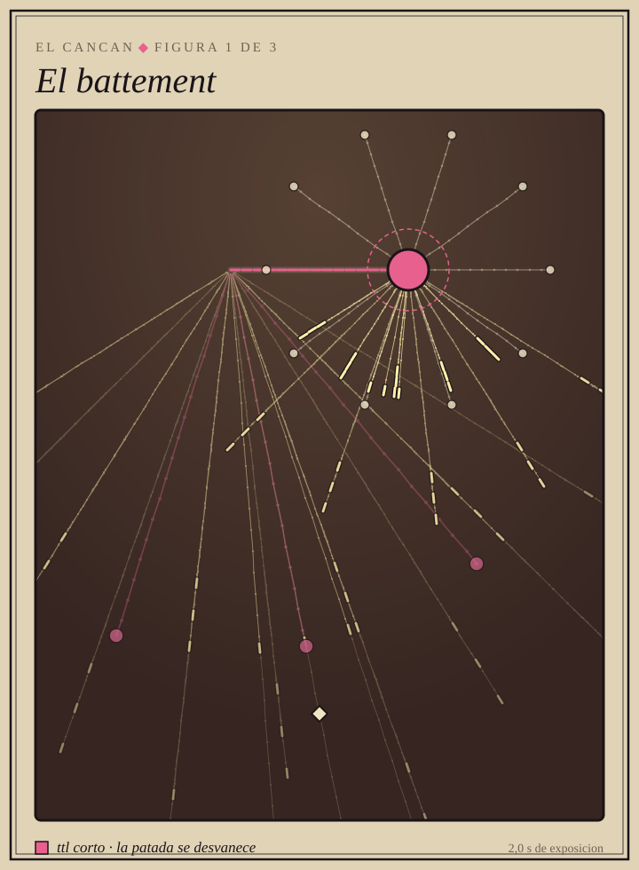 | **1. The battement.** On the floor: the high kick, the first one learned, in unison with the whole line.<br><br>In the game: five chorus girls, five legs, five spokes of needles fanning downward. One beat with the left and one with the right, and each leg lands in the previous one's gap: this beat's gap is the next beat's kick. |
| 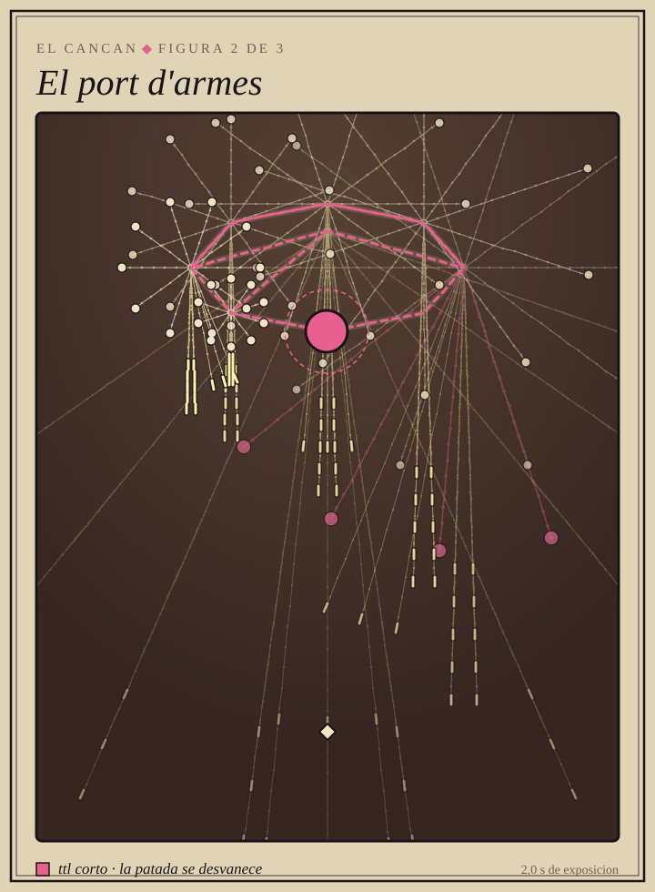 | **2. The port d'armes.** On the floor: the leg held by the ankle, almost vertical, spinning while hopping on the other foot.<br><br>In the game: the boss circles in eight hops around an ellipse. At each hop the raised leg drops straight down as a column of needles and the supporting foot releases a ring that quickly fades out. The columns sweep the floor to the rhythm of the spin. |
|  | **3. The cartwheel and the grand ecart.** On the floor: the sideways cartwheel and the leap that lands in the splits, the classic finale.<br><br>In the game: two bars of kicks on the eighth note; then the cartwheel crosses the floor in four hops, an eight-spoke ring rotated half a spoke each time, which is what makes it roll. And the splits: two fans to the corners, and the safe spot is right between its legs. |

## Flamenco

**Seville, the cafes cantantes of the late 19th century.** Dancing por
bulerias: the guitar calls, the dance answers, and everything is measured in a
twelve-beat compas unlike anything else in the night.

**The verb: `quiebro`.** The bullet flies straight and on every accent of the
compas it snaps aside, one way and then the other: it zigzags around its
heading. It isn't an arc, that belongs to the charleston, nor a turn of the
aim, that belongs to the waltz: the bullet is already out and changes its mind
in mid-air. Aimed shots never snap, which is what stops you from resting in a
gap of the zigzag.

```ron
quiebro: 0.5,   // radians it snaps on each accent
```

**The object: a guitar**, its mouth in the soundhole, a carnation on the
headstock and polka-dot ruffles. It tenses as it loses health, and when it
falls its strings snap one by one.

**The music:** Albeniz's *Asturias (Leyenda)* (1892). The compas has twelve
beats, accented on 3, 6, 8, 10 and 12: 20 ticks per beat and 240 per bar.

| | |
|---|---|
| 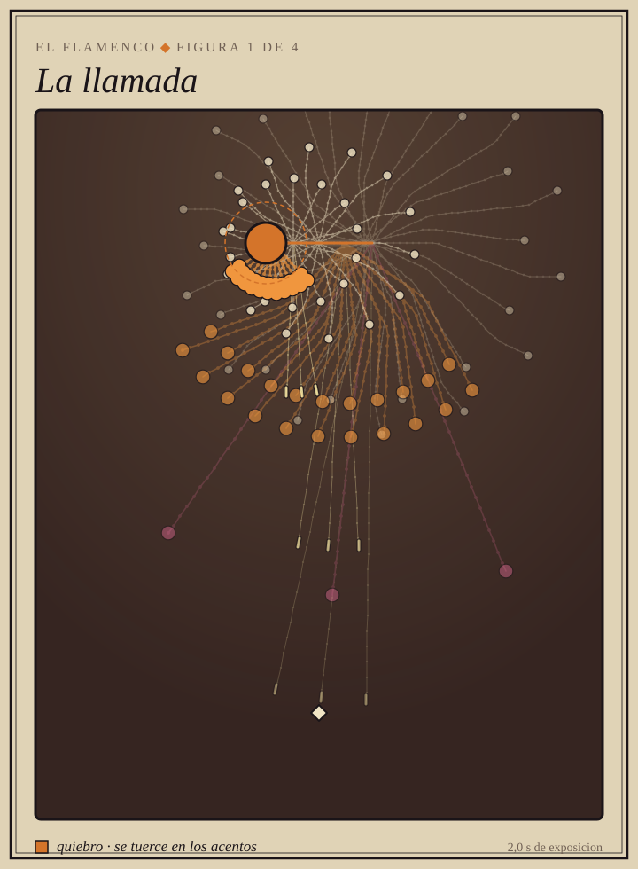 | **1. La llamada (the call).** On the floor: the guitar announcing that the dance begins.<br><br>In the game: the whole compas, plain. A fan on every accent and a ring on every beat that isn't one, and everything snaps: what you learn here is when a bullet coming at you will turn. |
| 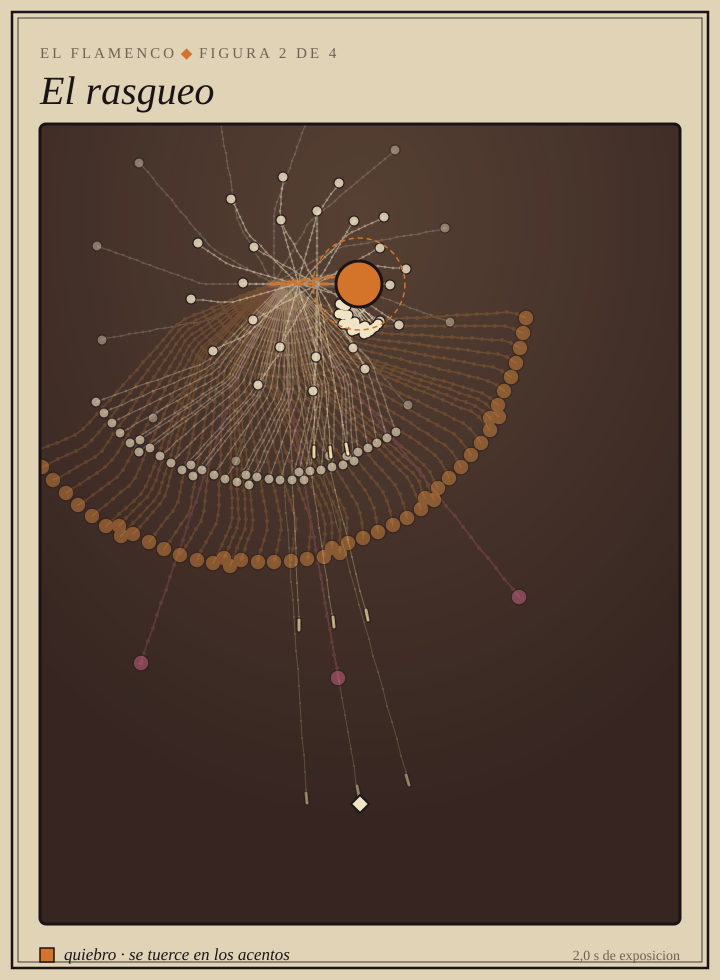 | **2. El rasgueo (the strum).** On the floor: the open hand sweeping the strings with every finger, one after another.<br><br>In the game: not a blow but a curtain crossing the room. You dodge it by crossing behind the last string, not by waiting for it to pass. |
|  | **3. El zapateado (the footwork).** On the floor: the feet alone, heel, sole and toe at full speed.<br><br>In the game: the tightest quiebro of all, almost half a right angle. What comes down is a lattice that bends on every accent. |
| 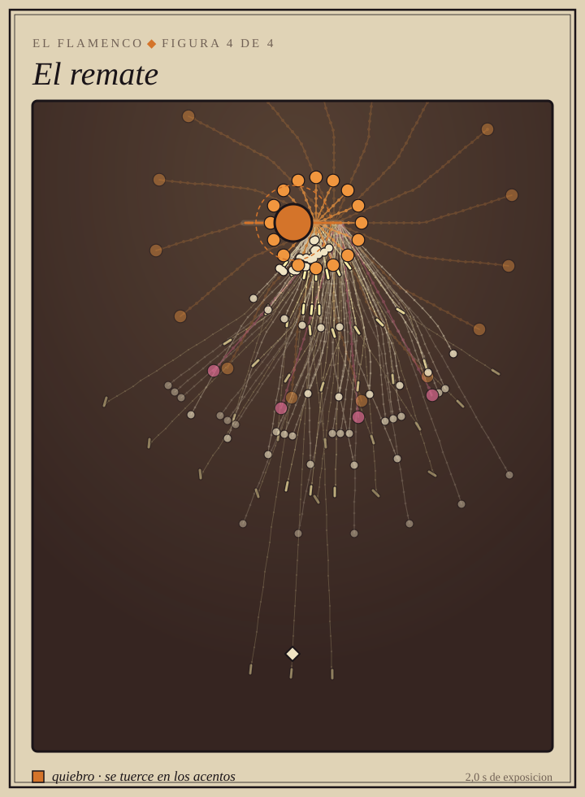 | **4. El remate (the finish).** On the floor: the close of the buleria, guitar and feet together.<br><br>In the game: everything before, together, closed on the last twelve. It is the only dance at level `Final`, and it opens once the other four are won. |
